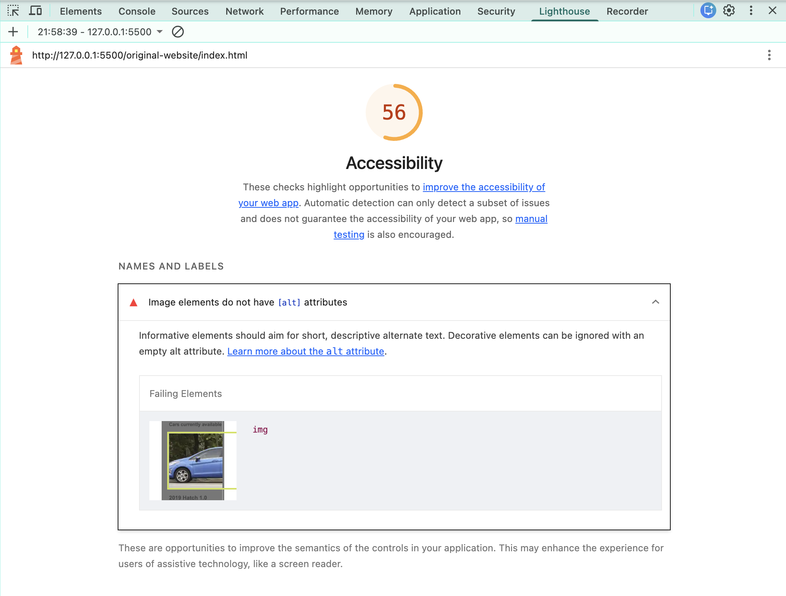
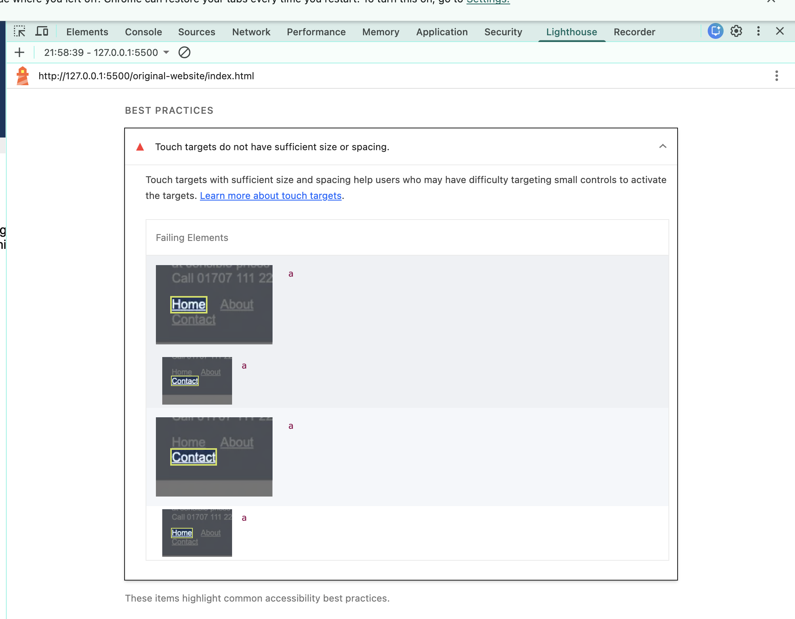
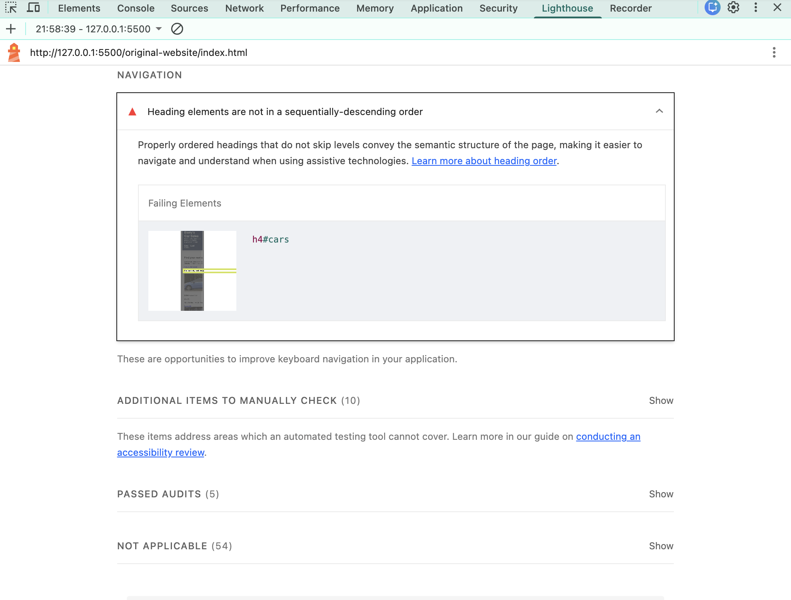
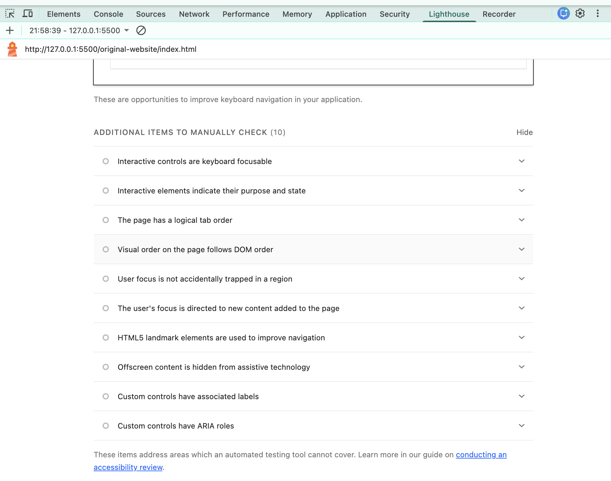

# Barry's Car Sales — Original Website Evaluation

## 1. Introduction

The original Barry's Car Sales website was evaluated to identify usability, accessibility, navigation and design problems. The evaluation involved manually testing the website, inspecting its pages and enquiry form, and using Google Lighthouse to identify accessibility issues.

The purpose was to identify areas requiring improvement before developing the redesigned website.

## 2. Lighthouse Accessibility Evaluation

The original website was tested using Google Lighthouse.

**Accessibility score: 56/100**

The following issues were identified:

- Images do not have alternative text (alt attributes).
- The HTML document does not specify a language attribute.
- Navigation links have insufficient touch-target size or spacing.
- Heading elements are not arranged in sequential descending order.

Manual keyboard testing was also conducted.

**Keyboard testing results:**
- Homepage navigation was accessible using Tab.
- All enquiry form fields were reachable using Tab.
- The keyboard focus order followed the expected sequence.
- Checkbox and radio-button positioning was visually misaligned.

## 3. Nielsen's 10 Usability Heuristics

### 1. Visibility of System Status

**Finding:** The website does not provide adequate feedback after an enquiry is submitted.

When the user submits the enquiry form, the browser displays a page-not-working error. There is no successful submission confirmation.

**Suggested improvement:** Introduce clear submission feedback and confirmation messages.

### 2. Match Between the System and the Real World

**Finding:**
- Vehicle descriptions are not sufficiently clear.
- Prices could be displayed more prominently.
- Some vehicle links use generic wording such as "Click here" and "More".

**Suggested improvement:** Use clearer vehicle descriptions, descriptive links and a more understandable presentation of vehicle specifications.

### 3. User Control and Freedom

**Finding:** Users can navigate between Home, About and Enquiry pages and return to the homepage.

However, the enquiry process does not provide a clear recovery option when an error occurs.

**Suggested improvement:** Maintain consistent navigation and provide an option to return to the enquiry form.

### 4. Consistency and Standards

**Finding:**
- Navigation links appear in different orders across pages.
- The Contact link is labelled Enquiry on another page.
- About is labelled About Us on another page.
- Form controls are visually misaligned.

**Suggested improvement:** Standardise navigation labels, ordering, spacing and page layouts.

### 5. Error Prevention

**Finding:**
- Empty, incorrect and correctly completed enquiry forms all lead to a page-not-working error.
- No useful validation feedback is displayed.
- Users are not informed about what information needs correcting.

**Suggested improvement:** Implement appropriate form validation, required-field indicators and clear error messages.

### 6. Recognition Rather Than Recall

**Finding:**
- Vehicle availability is not clearly identified.
- Customers have to guess whether displayed vehicles are available.
- There is no separate detailed vehicle information page.
- Enquiry links differ between vehicle listings.
- Navigation is only available at the top, requiring users to scroll upwards to access it.

**Suggested improvement:** Display vehicle availability, provide detailed vehicle pages, standardise enquiry links and improve navigation accessibility.

### 7. Flexibility and Efficiency of Use

**Finding:**
- No vehicle search bar is available.
- No filtering options are provided.
- No price-sorting functionality exists.
- Customers must manually scroll through the vehicle listings.

**Suggested improvement:** Introduce search, filtering and sorting options for price, mileage, fuel type and transmission.

### 8. Aesthetic and Minimalist Design

**Finding:**
- Website elements are poorly aligned.
- Excessive unused white space is present.
- Vehicle listings are arranged vertically.
- Images and text lack consistent positioning.
- The enquiry form appears unstructured.
- The overall website looks unfinished and unprofessional.

**Suggested improvement:** Introduce a consistent grid layout, professional vehicle cards, improved typography, spacing and a more organised enquiry form.

### 9. Help Users Recognise, Diagnose and Recover from Errors

**Finding:** When the enquiry form is submitted, the browser displays a generic error page.

- The error does not explain what went wrong.
- No instructions are provided to resolve the problem.
- There is no button to return to the enquiry form.

**Suggested improvement:** Provide understandable error messages, preserve entered information and allow users to return to the form.

### 10. Help and Documentation

**Finding:**
- No FAQ section is available.
- No dedicated help page exists.
- Financing guidance is unavailable.
- Test-drive instructions are not provided.
- Vehicle enquiry guidance is limited.
- A contact telephone number is available.

**Suggested improvement:** Introduce FAQs, customer support information, financing guidance and clear instructions for arranging test drives and vehicle enquiries.

## 4. Summary of Main Problems

The evaluation identified the following key areas requiring improvement:

1. Enquiry form submission and validation.
2. Accessibility and missing image descriptions.
3. Inconsistent navigation across pages.
4. Poor website alignment and visual presentation.
5. Lack of vehicle search and filtering.
6. Unclear vehicle availability and descriptions.
7. Limited customer support and guidance.
8. Poor error handling and recovery.

## 5. Conclusion

The evaluation identified several usability and accessibility weaknesses in the original Barry's Car Sales website.

Although basic navigation and keyboard accessibility were functional, the website lacked an effective enquiry process, consistent navigation, vehicle discovery features and a professional visual layout.

The findings will be used to guide the redesign and implementation process. The improved website will be tested again using manual accessibility checks and Google Lighthouse to evaluate the effectiveness of the changes.

## 6. Evaluation Evidence

Evidence collected during the evaluation includes:

- Google Lighthouse accessibility report (56/100).
- Screenshots of the original homepage.
- Screenshots of the About page.
- Screenshots of the vehicle enquiry form.
- Screenshots of the Lighthouse accessibility warnings.
- Manual keyboard navigation observations.
- Enquiry form submission and error observations.

These materials provide a baseline for comparison with the redesigned website.
### 6.1 Lighthouse Screenshot Evidence

The following screenshots provide visual evidence of the accessibility issues identified during testing.

**Screenshot 1: Accessibility Score and Missing Image Alt Text**

**Screenshot 2: Missing HTML Language Attribute**

**Screenshot 3: Touch Target Spacing Issues**

**Screenshot 4: Heading Order Issue**

**Screenshot 5: Additional Manual Accessibility Checks**

